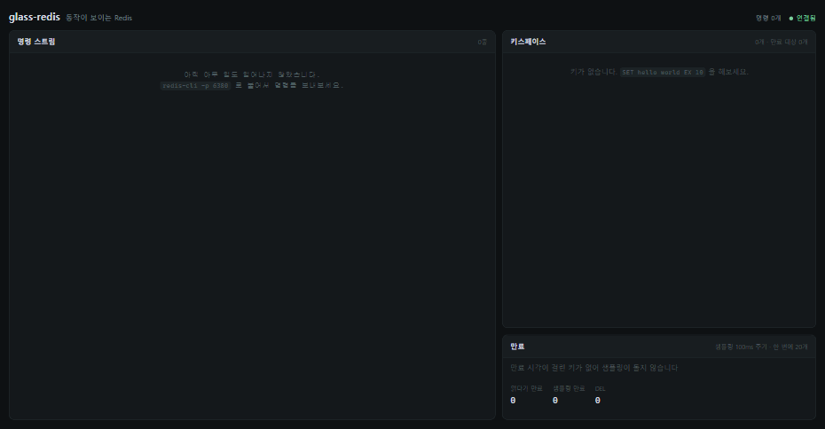

# glass-redis

Redis 서버를 Java로 직접 구현하고, **내부에서 벌어지는 일을 실시간으로 들여다보는** 프로젝트.



## 현재 상태

- 명령어 66개 — 문자열·만료(`SET` `GET` `EXPIRE` `TTL` …)와 List·Hash·Set·Sorted Set, `redis-cli` 로 그대로 접속
- 자료형 내부 인코딩(listpack·intset·quicklist·스킵 리스트)과 전환 기준까지 Redis 7 과 같게, `OBJECT ENCODING` 으로 확인
- 서버 내부를 실시간으로 그리는 대시보드 — 명령 스트림, 키스페이스, 만료
- AOF — 데이터를 바꾼 명령을 파일에 쌓고, 껐다 켜면 다시 실행해 복구. 커지면 `BGREWRITEAOF` 로 압축
  (파일 구성·기록 내용은 Redis 7 과 같게, 대시보드에 쌓이고 fsync 되고 압축되는 과정 표시)

만료된 키가 **언제 실제로 지워지는지**가 대시보드에 그대로 나온다.
`EX 10` 을 걸어도 10초에 지워지지 않고, 읽으러 온 명령이 발견하거나 100ms 마다 도는
샘플링이 그 키를 뽑아야 사라진다. 그 늦은 시간이 화면에 밀리초로 찍힌다.

## 왜 만드나

Redis, JAVA 밑단부터 복습 / 백엔드 실무 지식 쌓기

`SET key value EX 10` 을 치면 10초 뒤에 키가 사라진다는 건 알지만,
**누가 언제 그걸 지우는지**는 문서를 읽어도 잘 와닿지 않기에


1. `redis-cli`가 그대로 접속되는 Redis 호환 서버
2. 그 서버의 내부 상태를 실시간으로 그리는 대시보드

## 빌드 / 실행

Java 21 이상 필요

```bash
./gradlew build        # 빌드
./gradlew test         # 테스트
./gradlew run          # 실행 (서버 6380, 대시보드 8080)
```

대시보드는 Node 가 있으면 빌드가 알아서 만든다. 없으면 건너뛰고 서버만 돈다.

옵션: `--port` `--bind` `--dashboard-port` `--no-dashboard`

AOF 는 Redis 처럼 기본 꺼짐:

```bash
./gradlew run --args="--appendonly yes"                     # ./appendonlydir 에 기록
./gradlew run --args="--appendonly yes --dir data --auto-aof-rewrite-min-size 64kb"
```

AOF 옵션: `--appendonly` `--dir` `--appendfsync` `--auto-aof-rewrite-percentage` `--auto-aof-rewrite-min-size`

## 라이선스

MIT
