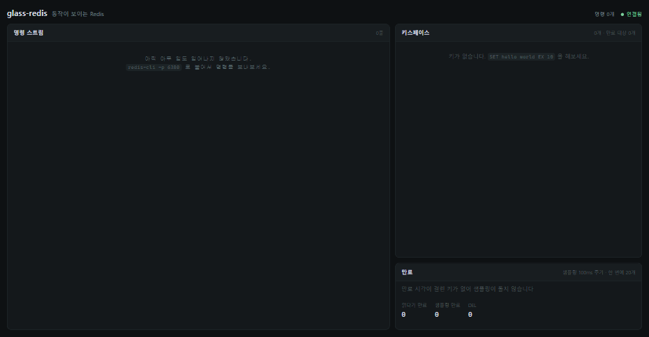

# glass-redis

Redis 서버를 Java로 직접 구현해 **내부에서 벌어지는 일을 실시간으로 들여다보는** 프로젝트.



## 현재 상태

- 명령어 68개
  - 문자열·만료(`SET` `GET` `EXPIRE` `TTL` …)와 List·Hash·Set·Sorted Set, `redis-cli` 로 그대로 접속
- Redis 7 기준으로 동일하게 맞추며 진행
- 서버 내부를 실시간으로 그리는 대시보드
- AOF
  - 데이터를 바꾼 명령을 파일에 쌓고, 껐다 켜면 다시 실행해 복구. 커지면 `BGREWRITEAOF` 로 압축
  (파일 구성·기록 내용은 Redis 7 과 동일, 대시보드에 쌓이고 fsync 되고 압축되는 과정 표시)
- RDB 스냅샷 - `SAVE` `BGSAVE`, save 규칙에 따른 자동 저장, 종료 시 저장, 기동 시 `dump.rdb` 복구
  (Redis 7.2 와 같은 바이트라 서로의 파일을 읽음, AOF 재작성 base 도 RDB 형식)

만료된 키가 **언제 실제로 지워지는지**를 대시보드로 표기
`EX 10` 을 걸어도 10초에 지워지지 않고, 읽으러 온 명령이 발견하거나 100ms 마다 도는
샘플링이 그 키를 뽑아야 사라짐

## 왜 만드나

Redis, JAVA 밑단부터 복습 / 백엔드 실무 지식 쌓기

`SET key value EX 10` 을 치면 10초 뒤에 키가 사라진다는 건 알지만,
**누가 언제 그걸 지우는지**는 문서를 읽어도 잘 와닿지 않으니까 직접 해보자


1. `redis-cli`가 그대로 접속되는 Redis 호환 서버
2. 그 서버의 내부 상태를 실시간으로 그리는 대시보드

## 빌드 / 실행

Java 21 이상 필요

```bash
./gradlew build        # 빌드
./gradlew test         # 테스트
./gradlew run          # 실행 (서버 6380, 대시보드 8080)
```


옵션: `--port` `--bind` `--dashboard-port` `--no-dashboard`

AOF 는 Redis 처럼 기본 꺼짐:

```bash
./gradlew run --args="--appendonly yes"                     # ./appendonlydir 에 기록
./gradlew run --args="--appendonly yes --dir data --auto-aof-rewrite-min-size 64kb"
```

AOF 옵션: `--appendonly` `--dir` `--appendfsync` `--auto-aof-rewrite-percentage` `--auto-aof-rewrite-min-size` `--aof-use-rdb-preamble`

RDB 는 Redis 처럼 기본 save 규칙(`3600 1 300 100 60 10000`)으로 켜짐:

```bash
./gradlew run --args="--save ''"                            # 자동 저장 끔 (SAVE·BGSAVE 는 그대로)
./gradlew run --args="--dir data --save '60 1000'"          # 60초 안에 1000번 바뀌면 data/dump.rdb
```

RDB 옵션: `--dir` `--dbfilename` `--save` `--stop-writes-on-bgsave-error`

## 처리량

실제 Redis 7.2.4 와 같은 조건으로 `redis-benchmark` 테스트 (초당 요청 수, 3회 중앙값)

| | Redis 7.2.4 | glass-redis |
|---|---:|---:|
| `SET` | 13.1만 | 6.1만 |
| `GET` | 12.8만 | 6.3만 |
| `SET` 파이프라인 16 | 79만 | 56만 |
| `GET` 파이프라인 16 | 94만 | 74만 |
| `SET` 파이프라인 16, AOF everysec | 44만 | 54만 |
| `BGSAVE` 동안 명령이 멈추는 시간 (키 26만 개) | 약 1ms | 17~46ms |

- 서버·벤치마크 모두 Docker 컨테이너, 각각 `--cpus 2` (i5-1240P, Docker Desktop WSL2)
- `redis-benchmark -t set,get -n 300000 -c 50 [-P 16]`, 대시보드 X

## 라이선스

MIT
